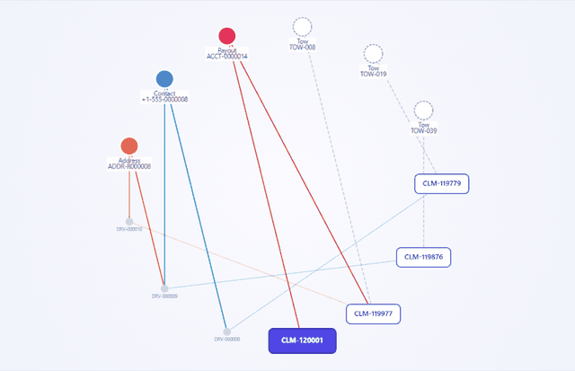
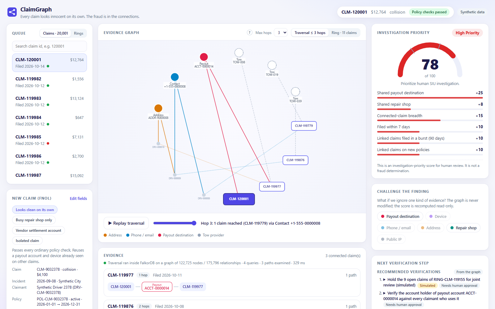
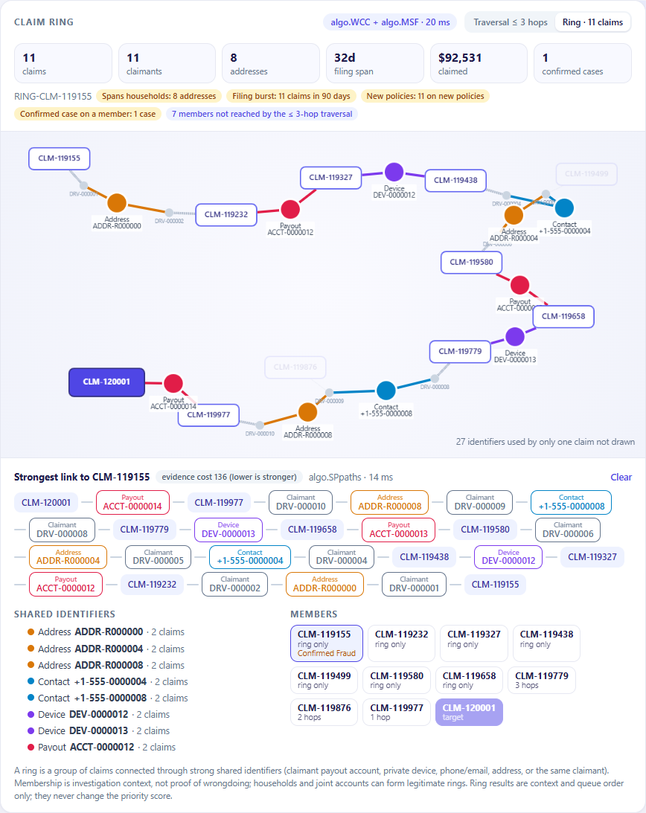
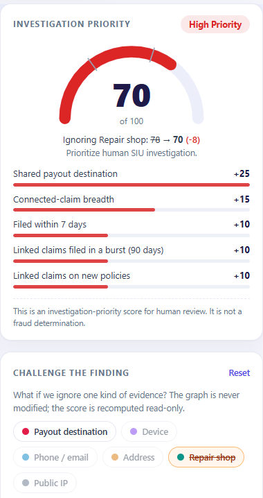
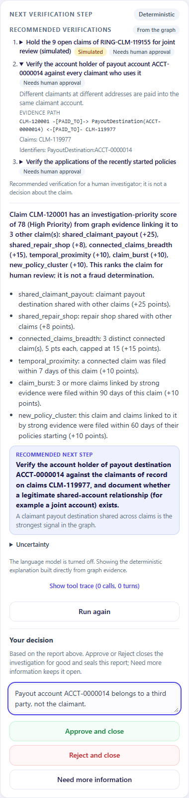
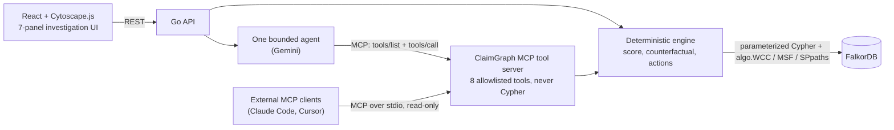
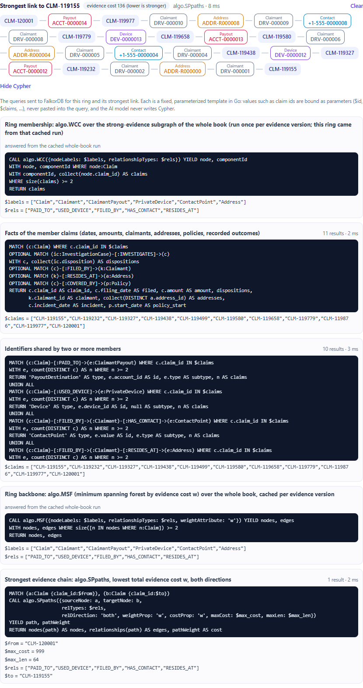
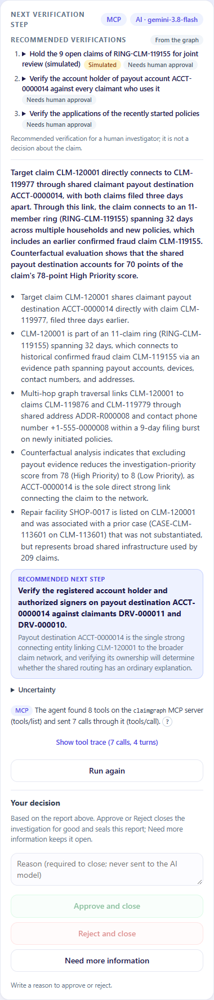

# ClaimGraph

Built for [Graph Hacks: Context for AI Agents](https://www.wemakedevs.org/hackathons/falkordb) (WeMakeDevs × FalkorDB), **Track 01: Agents That Act on Connected Data**. All data is synthetic.

**Every claim looks innocent on its own. The fraud is in the connections.**

- **The Problem:** Some people work together to file fake insurance claims. Each claim looks normal when you check it alone: the policy is valid and the amount is reasonable. The clue is what the claims have in common: different people get paid into the same bank account, use the same phone or device, or live at the same address. Insurers usually check one claim at a time, so they miss these links.

- **The Solution:** ClaimGraph is an investigation copilot for insurance fraud teams. A new auto claim comes in, FalkorDB finds how it connects to every other claim through shared payout accounts, devices, phones and addresses, and the investigator gets a priority score in which every point traces back to a real path in the graph. A graph database stores the links between claims, so they are easy to find. A bounded AI agent explains the findings. A human makes every decision.

<p align="center"></p>
<p align="center"><sub>A claim that passed every ordinary policy check, traced 3 hops into a fraud ring. Each hop is a real FalkorDB path.</sub></p>

## Contents

- [What it does](#what-it-does): the 10 steps from a new claim to a closed investigation
  - [How it meets the hackathon brief](#how-it-meets-the-hackathon-brief)
- [Quick start](#quick-start-about-2-minutes): run it with one command
  - [Try the demo](#try-the-demo)
- [How it works](#how-it-works): graph model, search rules, score, key Cypher queries
- [Results](#results)
  - [The 30 test scenarios](#the-30-test-scenarios): what T01–T30 are
  - [At scale](#at-scale): the 20,000-claim book
- [Why FalkorDB](#why-falkordb-a-measured-comparison): measured against PostgreSQL
- [The agent and its limits](#the-agent-and-its-limits): MCP and safety checks
  - [The tools](#the-tools): the 8 tools the agent can call
- [Known limitations](#known-limitations)
- [Run the tests](#run-the-tests)
- [Local development](#local-development)
- [Repository](#repository): where the code lives
- [How this was built](#how-this-was-built-and-how-ai-was-used): the idea and how AI was used
- [License](#license)

## What it does



1. **A new claim comes in.** The insurer receives the first report of a claim, called the FNOL (_first notice of loss_). The usual checks run: is the policy active, did the accident happen while it was active, is the amount within the limit? A claim from a fraud ring can pass all three. If the new claim joins a known ring, an alert appears straight away.
2. **It is saved as a graph.** The claim and everything attached to it (the person, the bank account to pay, phone, device, address, repair shop, IP address) are stored in FalkorDB as nodes joined by relationships.
3. **The graph is searched.** FalkorDB follows the links from the new claim up to 3 steps ("hops") away, for example: claim → shared bank account → another claim → shared address → a third claim. This search runs inside FalkorDB using fixed Cypher queries written in Go. The claim id is passed in as a parameter, and the AI never writes a query. The **Show Cypher** button in the app displays the exact queries.
4. **The whole ring is found.** FalkorDB's built-in graph algorithms look beyond 3 hops: `algo.WCC` finds every claim in the group, `algo.MSF` draws the strongest links that hold the group together, and `algo.SPpaths` finds the strongest chain of evidence between any two claims.
5. **A score explains it.** The claim gets a 0–100 priority score. Every point comes from a fixed rule (for example +25 for a shared bank account) and points to the exact link in the graph. No AI is used for the score.
6. **An AI agent writes the summary.** When the investigator asks, one AI agent (Gemini) connects to ClaimGraph's tools through **MCP** (Model Context Protocol, the standard way AI agents find and use tools). It chooses from [8 tools](#the-tools), reads the graph, and writes a plain-English summary and next step. Every claim id it mentions is checked against what the tools returned; if anything is wrong, a summary built directly from the graph is shown instead.
7. **The investigator can test the result.** Remove one kind of evidence (for example the shared repair shop) and see what the score would be without it. The graph itself is never changed.
8. **Next steps are suggested.** The graph suggests what to verify, such as "check who owns bank account ACCT-0000014". Each step shows the evidence behind it and needs a person to approve it.
9. **The investigator decides.** Under the report there are three buttons: **Approve and close** (no fraud found), **Reject and close** (fraud confirmed) and **Need more information** (stays open). Closing needs a written reason, saves the exact report that was read (score, evidence, summary, and the tools the agent used) in FalkorDB, and locks the claim.
10. **The graph remembers.** Decisions stay in the graph for future investigations. If a claim is rejected, any later claim linked to it gets +15 points.

| The whole ring (`algo.WCC` + `algo.MSF`) and the strongest chain (`algo.SPpaths`) | Testing the score without one kind of evidence    | Next steps, the report, and the investigator's decision |
| --------------------------------------------------------------------------------- | ------------------------------------------------- | ------------------------------------------------------- |
|                                                 |  |    |

### How it meets the hackathon brief

| Required by the rules / Track 01                                 | Where it is                                                                                                                                                     |
| ---------------------------------------------------------------- | --------------------------------------------------------------------------------------------------------------------------------------------------------------- |
| FalkorDB is the main database and does real work (rules 2 and 3) | The search, the ring algorithms and the decision memory all run in FalkorDB; without it nothing works. See [Why FalkorDB](#why-falkordb-a-measured-comparison). |
| Multi-hop reasoning                                              | Steps 3–4: up to 3 hops per search, any depth for rings.                                                                                                        |
| Graph queries and algorithms as agent tools                      | [The tools](#the-tools) include `FindRelatedClaims` (the 3-hop search), `GetClaimRing` (`algo.WCC` + `algo.MSF`) and `GetStrongestLink` (`algo.SPpaths`).       |
| Tool selection through MCP                                       | Step 6; also usable from any MCP client ([details](#the-agent-and-its-limits)).                                                                                 |
| Actions based on what the graph shows                            | Steps 1, 8 and 9: ring alert at intake, graph-based next steps, closing and locking a claim.                                                                    |
| Explainable results / showing the path behind an answer          | Steps 3, 5 and 9: every point tied to a path, Show Cypher, the sealed report.                                                                                   |
| Remembers what it learns                                         | Step 10.                                                                                                                                                        |
| README with setup instructions and graph data model              | [Quick start](#quick-start-about-2-minutes) and [How it works](#how-it-works).                                                                                  |
| The Cypher queries and graph algorithms used                     | [Key Cypher](#how-it-works) and Show Cypher in the app.                                                                                                         |
| Allowed data only (rule 6)                                       | All data is synthetic, generated by this project.                                                                                                               |
| AI assistance disclosed (rule 11)                                | [How this was built](#how-this-was-built-and-how-ai-was-used).                                                                                                  |

## Quick start (about 2 minutes)

Requires Docker.

```bash
git clone https://github.com/aswin2108/ClaimsAgent.git
cd ClaimsAgent
docker compose up --build
```

Open **http://localhost:5173**. The first start loads a synthetic book of 20,000 claims with 12 hidden fraud rings, which takes about 10 seconds. Everything binds to `127.0.0.1` only.

### Try the demo

1. **Submit a claim.** In the **New claim (FNOL)** card, the _Showcase_ claim is already selected. Press **Submit synthetic FNOL**. It passes all three policy checks, but a ring alert appears.
2. **Watch the search.** The graph shows the claim linking to others: first a shared bank account, then an address, then a phone. The score is **78, High Priority**, and every point is explained.
3. **See the whole ring.** Open the **Ring** tab: 11 claims, 8 addresses, all filed within 32 days. Click the claim marked _Confirmed Fraud_ to see the chain of 9 claims that links it to yours.
4. **Test the score.** Under **Challenge the finding**, click _Repair shop_. The score drops by only 8, so the rest of the evidence still holds.
5. **Ask the AI, then decide.** Click **Run investigation agent** and read the report. Type a reason and click **Reject and close**. The claim is locked and marked _Rejected_, and you can still open the saved report.
6. **Start again.** Click **Reset demo** (top right, twice).

Optional: put `API_Gemini=<your key>` in `Secrets/.env` to enable the AI agent. Without a key, the agent button returns the deterministic explanation instead. Ports and limits can be changed in `.env` (see `.env.example`).

## How it works



**Graph model.** Claims never link to each other directly. Every connection is discovered through a shared identifier.

| Node                        | Key properties                                                                         | Example (synthetic)              |
| --------------------------- | -------------------------------------------------------------------------------------- | -------------------------------- |
| `Claim`                     | claim_id, incident_date, filing_date, amount, loss_type, status, policy_check_status   | `CLM-120001`, collision, $12,764 |
| `Claimant`                  | claimant_id, name, is_driver                                                           | `DRV-000011`                     |
| `Policy`                    | policy_id, start_date, end_date, status                                                | `POL-0000011`, active            |
| `Vehicle`                   | vin                                                                                    | `SYN00000000000011`              |
| `PayoutDestination`         | account_id, type (`claimant` or `vendor_direct_settlement`)                            | `ACCT-0000014`                   |
| `ContactPoint`              | type (`phone` / `email`), value                                                        | `+1-555-0000011`                 |
| `Address`                   | address_id                                                                             | `ADDR-R000010`                   |
| `Device`                    | device_id, is_public                                                                   | `DEV-0000011`                    |
| `IPAddress`                 | ip, is_public                                                                          | `2001:db8:fffe:a::1`             |
| `RepairShop`, `TowProvider` | shop_id / tow_id, name                                                                 | `SHOP-0017`, `TOW-008`           |
| `InvestigationCase`         | case_id, disposition, notes, timestamp; when closed: outcome, closed_at, sealed_report | `CASE-CLM-120001`                |

```
(Claim)-[:PAID_TO]->(PayoutDestination)     (Claim)-[:FILED_BY]->(Claimant)-[:HAS_CONTACT]->(ContactPoint)
(Claim)-[:USED_DEVICE]->(Device)            (Claimant)-[:RESIDES_AT]->(Address)
(Claim)-[:REPAIRED_AT]->(RepairShop)        (Claim)-[:COVERED_BY]->(Policy)   (Claim)-[:INVOLVES]->(Vehicle)
(Claim)-[:FILED_FROM]->(IPAddress)          (InvestigationCase)-[:INVESTIGATES]->(Claim)   <- decisions become graph memory
```

**Traversal rules.** These are what keep the results credible at 20,000 claims:

- A vendor settlement account (the repair shop is paid directly), a shared public computer or a company-network IP never connects claims.
- A shop or public IP used by more than 20 claims counts once, as infrastructure.
- A hub with more than 100 links is never expanded past the first hop.
- A household (the same claimant, or people at the same address) counts as one unit.

**Score (0–100, investigation priority, not probability of fraud).** Each factor counts once:

| Shared payout account | Shared private device | Shared phone/email | Shared address | Shared repair shop | Shared public IP |
| --------------------- | --------------------- | ------------------ | -------------- | ------------------ | ---------------- |
| +25                   | +20                   | +12                | +10            | +8                 | +3               |

Plus: connected claims (+5 each, up to +15), a link filed within 7 days (+10), a confirmed fraud case on an earlier linked claim (+15), two or more independent strong signals (+10), a burst of strongly linked claims within 90 days (+10), and linked claims on brand-new policies (+10). The total is capped at 100. Bands: **0–29 Low**, **30–59 Review**, **60–100 High Priority**.

**Where points are reduced or not given.** These rules came from testing on the 20,000-claim book, where ordinary sharing produced too many false alarms:

| Situation                                                                                        | What happens                                                                                                                                                                                                |
| ------------------------------------------------------------------------------------------------ | ----------------------------------------------------------------------------------------------------------------------------------------------------------------------------------------------------------- |
| Vendor settlement account, shared public computer, company-network IP                            | 0 points, and never a connection.                                                                                                                                                                           |
| A repair shop or public IP used by more than 20 claims                                           | Counts once (+8 / +3), but its other claims are not connections: no breadth, timing or burst points.                                                                                                        |
| Two claims by the same person                                                                    | Not linked through their payout, device, shop or IP.                                                                                                                                                        |
| A household: every strong link stays with the same claimant or people at the claimant's address  | The household counts as one unit: no breadth, timing, burst or new-policy points, and no +10 for two signals. The shared address or joint account itself still counts, with a note that it may be innocent. |
| Shops and IPs                                                                                    | Never earn burst or new-policy points; only payout, device, phone and address links do.                                                                                                                     |
| An earlier linked claim decided as _No Fraud Found_ (approved) or still _Needs More Information_ | 0 points; only a confirmed fraud case adds +15.                                                                                                                                                             |

For example, a claim sharing only an address with four neighbours scores **10 (Low)**, and a couple sharing a joint account scores **35 (Review)**. A planted ring still scores High (156 of 156 ring claims).

**Key Cypher.** All queries are fixed, parameterized templates in Go; the model never writes Cypher.

```cypher
// One hop of the traversal (simplified): claims sharing the target's payout account.
// Staged MATCH clauses so the guards prune before the next expansion.
MATCH (x0:Claim {claim_id: $id})-[a:PAID_TO]->(e0)
WHERE NOT ((indegree(e0) > $infra OR a.w >= 1000) AND a.w > 10)   // context-only / infrastructure guard
WITH x0, a, e0
MATCH (e0)<-[b:PAID_TO]-(x1:Claim)
WHERE ID(x0) <> ID(x1) AND NOT (x0)-[:FILED_BY]->()<-[:FILED_BY]-(x1)  // same claimant is not a link
RETURN [x0, e0, x1] AS nodes, [a, b] AS edges

// Every ring in the book: connected components over strong evidence only.
CALL algo.WCC({nodeLabels: ['Claim','Claimant','ClaimantPayout','PrivateDevice','ContactPoint','Address'],
               relationshipTypes: ['PAID_TO','USED_DEVICE','FILED_BY','HAS_CONTACT','RESIDES_AT']})
YIELD node, componentId

// The strongest evidence chain between two claims, at any depth (lower evidence cost = stronger).
CALL algo.SPpaths({sourceNode: a, targetNode: b, relTypes: $rels, relDirection: 'both',
                   weightProp: 'w', costProp: 'w', maxCost: 999, maxLen: $max_len})
YIELD path, pathWeight
```

The full traversal (all path shapes up to 3 hops) is in [`backend/internal/investigate/traverse.go`](backend/internal/investigate/traverse.go), and the algorithms are in [`backend/internal/graphalgo`](backend/internal/graphalgo).

**Show Cypher.** In the app, the Evidence panel and the Ring view each have a _Show Cypher_ toggle that displays the exact queries sent to FalkorDB for the claim on screen, with their bound parameters, result counts and timings (or "answered from the cached whole-book run" for `algo.WCC` / `algo.MSF`). Tests check that every `$parameter` in a logged query has its value logged and that no claim id is ever pasted into query text.

<p align="center"></p>

## Results

### The 30 test scenarios

I wrote 30 small made-up cases, numbered **T01 to T30**. Each one is built in its own empty graph, and the score it should get was worked out by hand before the code was written. The tests check the exact score, the band, and that the expected evidence paths are found. No AI is used, so the results are the same on every run.

| Cases                                                | What they test                                                                                                                                                                                                                          | Example                                                                                                           |
| ---------------------------------------------------- | --------------------------------------------------------------------------------------------------------------------------------------------------------------------------------------------------------------------------------------- | ----------------------------------------------------------------------------------------------------------------- |
| **T01–T10: suspicious**                              | Patterns a fraud ring leaves behind: a shared bank account and device, a chain of claims several hops long, claims filed within days of each other, a link to a confirmed fraud case. Each should be flagged (Review or High Priority). | T08: a chain of claims linked by a bank account, then a phone or email, then an address → **90, High Priority**   |
| **T11–T20: innocent look-alikes** (_hard negatives_) | Ordinary sharing that must **not** be marked High Priority: a busy repair shop, a shared public IP address, neighbours at one address, a couple with a joint account, a repair shop paid directly.                                      | T14: a couple sharing a bank account and an address → **35, Review**, with a note that it may be innocent         |
| **T21–T25: limits and memory**                       | Limits on timing and breadth (a busy shop cannot add points without end), and earlier decisions: they are read back from the graph, but only a _confirmed fraud_ decision adds points.                                                  | T23: linked to an earlier claim found _not substantiated_ → the decision is shown, **no** extra points            |
| **T26–T30: challenge and safety**                    | Removing one kind of evidence, a claim with no links, the AI timing out, and a tool call that tries to run its own Cypher.                                                                                                              | T26: remove the repair shop → the score drops by exactly 8; T30: the Cypher is refused and the graph is unchanged |

| Tests passing | Suspicious cases flagged (T01–T10) | Innocent cases wrongly marked High Priority (T11–T20) |
| ------------- | ---------------------------------- | ----------------------------------------------------- |
| **30 / 30**   | **10 / 10**                        | **0 / 10**                                            |

Every case and its expected score is listed in `Idea.txt` section 7; the tests are in `backend/internal/eval`.

### At scale

A synthetic book of 20,000 claims (122,455 nodes, 175,527 relationships) with 12 planted fraud rings ([full report](backend/testdata/scale/benchmark.md)):

- All 156 planted-ring claims are **High Priority**. Only 5 of 200 random claims are (2.5%).
- **12 of 12** planted rings are recovered exactly by `algo.WCC`, and all 12 rank in the top 12 of 2,998 groups.
- A full investigation takes about 140–185 ms (median). A ring lookup takes 7 ms, a strongest evidence chain 4 ms.

## Why FalkorDB: a measured comparison

I asked FalkorDB and PostgreSQL 18 the same questions on the same 20,000-claim book. Both returned identical answers on all 24,264 comparisons ([full report](backend/testdata/scale/benchmark_relational.md)).

| Question                              | FalkorDB  | PostgreSQL |                               |
| ------------------------------------- | --------- | ---------- | ----------------------------- |
| Every ring in the book                | **85 ms** | 3,405 ms   | **FalkorDB 40× faster**       |
| Strongest evidence chain at any depth | **7 ms**  | 195 ms     | **FalkorDB 28× faster**       |
| Connected claims within 1–3 hops      | 24–150 ms | 2–6 ms     | PostgreSQL faster, once tuned |

Finding rings across the whole book and the strongest chain at any depth each take one built-in FalkorDB call (`algo.WCC`, `algo.SPpaths`). Plain PostgreSQL needs dozens of full-table iterations for the same answers. For short lookups from a single claim, a tuned relational index is faster; untuned, the same 3-hop SQL took about 650 ms. Both sides are reported.

## The agent and its limits

<p align="center"></p>
<p align="center"><sub>A real run: Gemini picked 7 of the 8 tools it discovered over MCP; every claim id it cites was returned by a tool.</sub></p>

- **Tools are selected through MCP.** The agent has no tools built in. Each run connects to the ClaimGraph MCP server, discovers the tools with `tools/list`, offers exactly those to the model, and sends every call as `tools/call`. The Next-step panel shows this for every run ("found 8 tools on the claimgraph MCP server and sent 8 calls through it").
- **One agent, eight allowlisted tools** (listed [below](#the-tools)). The tool server validates every input strictly; out-of-scope ids count as violations, and 3 violations end the run.
- **The model never writes Cypher.** The score is computed in Go before the model runs.
- **Output validation.** Every id the model cites must have come back from a tool in that run, and accusatory or claim-decision language is rejected. On any failure or timeout, the deterministic explanation is used instead.
- **Cost limits.** At most 8 turns, 10 tool calls and 150k tokens per run, plus hourly and daily budgets. The LLM is only called when a person clicks the button.
- **Privacy.** Claimant names and investigator notes are never sent to the model.
- **Any MCP client can use the same tools** (read-only; recording a decision stays in the UI): `cd backend && claude mcp add claimgraph -- go run ./cmd/mcp`.

### The tools

Each tool is Go code that runs fixed, parameterized Cypher against FalkorDB and returns plain data (never the query). The agent can only look at the claim being investigated and at claims a tool has already shown it in the same run.

| Tool                            | What it does                                                                                                                                                      | Runs on FalkorDB                                |
| ------------------------------- | ----------------------------------------------------------------------------------------------------------------------------------------------------------------- | ----------------------------------------------- |
| `GetClaim`                      | The claim's stored facts and its policy-check results.                                                                                                            | Claim lookup                                    |
| `FindRelatedClaims`             | Every claim linked to this one within 1–3 hops, and how far away each is.                                                                                         | The multi-hop search                            |
| `GetEvidencePaths`              | The exact chain of shared identifiers (with evidence ids and dates) between this claim and one related claim.                                                     | Path query between the two claims               |
| `GetPriorCases`                 | Earlier investigator decisions on claims that use the same identifiers.                                                                                           | Investigation history                           |
| `RunCounterfactual`             | The score as if one kind of evidence were ignored. Read-only.                                                                                                     | The multi-hop search, without that relationship |
| `GetClaimRing`                  | The whole ring this claim belongs to, at any depth: members, shared identifiers, the most-shared one, filing span, recorded decisions, and the backbone of links. | `algo.WCC` + `algo.MSF`                         |
| `GetStrongestLink`              | The strongest chain of evidence between this claim and another one, at any depth.                                                                                 | `algo.SPpaths`                                  |
| `RecordInvestigatorDisposition` | Saves the investigator's decision. It only works if a person made that exact decision in the app; the AI cannot choose one.                                       | Writes an `InvestigationCase`                   |

The MCP server for outside clients (`cmd/mcp`) offers the seven read-only tools plus `BeginInvestigation` (starts an investigation and returns the score) and `ListClaimRings` (every ring in the book, in review order). It does not offer `RecordInvestigatorDisposition`.

## Known limitations

- **Synthetic data only.** The 20,000-claim book and its 12 rings come from this project's generator (`internal/synth`), so the results show the method works on planted patterns, not real-world accuracy.
- **The score weights are set by hand**, from investigator reasoning (a shared payout account matters more than a shared repair shop). Nothing is learned from data, by design: every point has to be explainable.
- **Short lookups are not FalkorDB's speed story.** Tuned PostgreSQL answers 1–3 hop questions faster (see above). FalkorDB wins on whole-book rings and any-depth chains, and on returning paths as evidence.
- **WCC and MSF process the whole strong-evidence graph per call** (about 0.1–0.3 s at 20k claims). Results are cached until the evidence changes.
- **No authentication.** It is a local demo; everything binds to 127.0.0.1.
- **External MCP clients' answers are not validated.** The built-in agent's output is checked against what the tools returned; an outside client's prose is its own.

## Run the tests

```bash
docker compose --profile test run --rm eval        # whole Go suite incl. the 30 scenarios (uses the compose FalkorDB)

cd backend && go test ./... -count=1                # same, against FalkorDB on localhost:6379
cd frontend && npm test                             # UI tests (mocked API; counts every request a button sends)
cd frontend && npm run test:e2e                     # real Chrome -> Vite -> Go API -> FalkorDB, LLM disabled
```

Benchmarks: `cd backend && go run ./cmd/bench`, and for the PostgreSQL comparison `docker compose --profile bench up -d postgres-bench`, then `go run ./cmd/benchrel`.

## Local development

```bash
docker compose up -d falkordb                     # FalkorDB on 127.0.0.1:6379 (browser UI on :3000)
cd backend && go run ./cmd/seed && go run ./cmd/seedscale   # small curated graph + the 20,000-claim book
cd frontend && npm install && npm run dev:all     # Go API on :8080 + Vite on :5173
```

## Repository

```
backend/    Go (module claimgraph)
  cmd/        api, mcp, seed, seedscale, bench, benchrel, ...
  internal/   investigate (traversal), scoring, graphalgo (WCC/MSF/SPpaths), agent, actions,
              ingest, demo (reset), mcpserver, api, eval (T01-T30)
frontend/   React + TypeScript + Vite + Cytoscape.js
docs/images/  screenshots used here
docs/BUILD_LOG.md  dated log of decisions, bugs found and verification
LICENSE     MIT
```

**Stack:** FalkorDB · Go · React · TypeScript · Cytoscape.js · Gemini (optional) · MCP · Docker Compose

## How this was built, and how AI was used

**The idea.** I work in the insurance industry, and finding fraud hidden among ordinary-looking insurance claims is a problem I had been thinking about for a while. This hackathon was the chance to build it. I used AI to develop that idea into the design you see here.

**What AI did.** Most of the code was written with Claude Code (an AI coding assistant), working from my instructions and from a written plan kept in the repo (`Idea.txt`). Gemini is part of the product itself: it is the optional agent that writes the plain-language explanation, and the app works without it.

**What I did.**

- **Scope and data model.** I chose personal auto insurance only, and the data points the graph holds: claim, claimant/driver, vehicle, policy, repair shop, tow provider, payout destination, contact and device.
- **Direction.** I decided what to build and in what order. After each stage I asked for a review of the code and tests for every feature, including tests that count the requests each button fires.
- **Cost and safety.** I chose Gemini Flash, and asked for a review of every model call so a bug can't run up a bill. That review led to the per-run and per-day limits.
- **Testing by hand.** I ran the app myself and reported what was wrong. Many of the fixes came from that.
- **Scoring decisions.** No scoring change went in without my approval. I asked for every change to be studied on the 20,000-claim book first. The household rule went in only after the full study showed that (random claims marked High went from 11.9% to 2.8%, while 156 of 156 ring claims stayed High).
- **Product decisions.**
  - The demo submits a claim live and uses the 20k-claim book.
  - There is a Reset button so every visitor starts fresh. I dropped an autopilot demo idea.
  - Decisions are made under the agent's report, and closing an investigation is final: **Approve** or **Reject** by the investigator, with a reason, sealing the report that was read.
  - The app's own agent selects its tools through MCP, after I noticed that only outside clients used MCP.
  - A failed coverage check gets its own note instead of a misleading "Low priority".
- **Benchmark.** I chose PostgreSQL as the comparison and asked for the full version. I asked for the results to be reported as measured.
- **Commits.** I reviewed and committed every change myself.

**How the work was checked.** Every number in this README comes from code in this repository that you can re-run:

- the 30-scenario evaluation, with exact expected scores;
- parity tests against a second, independent traversal engine;
- browser end-to-end tests;
- the 20k-claim and PostgreSQL benchmarks.

A dated log of these decisions and fixes is in [docs/BUILD_LOG.md](docs/BUILD_LOG.md).

## License

[MIT](LICENSE) © 2026 Aswin.
